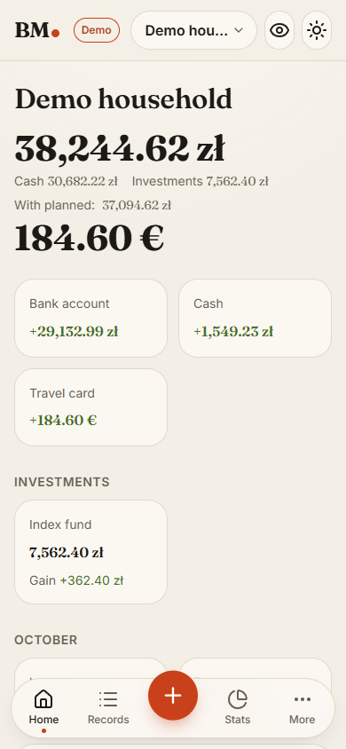
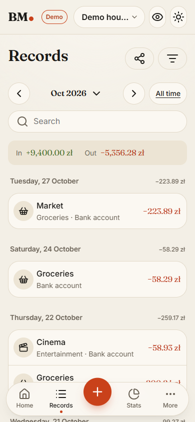
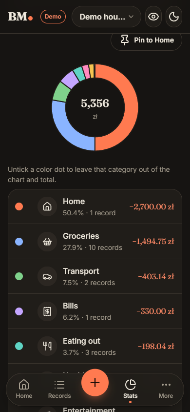

<h1 align="center">BM.</h1>

<p align="center">
  <strong>Personal finance that fits in your pocket.</strong><br>
  Private and shared wallets, budgets, recurring payments, investments and forecasts — built phone-first.
</p>

<p align="center">
  <a href="https://github.com/michalmrowiec/BM2/actions/workflows/ci.yml"></a>
  
  
  
</p>

<p align="center">
  
  &nbsp;
  
  &nbsp;
  
</p>

## Features

- **Fast entry** — adding a record takes under five seconds: templates, suggestions, one-tap repeat.
- **Wallets and sharing** — private and shared wallets with roles, per-account sharing and invitations.
- **Records** — expenses, income, transfers and refunds; pending and planned states; tags; multi-currency accounts.
- **Recurring payments** — rules that add occurrences on their own, with optional confirmation.
- **Budgets** — monthly limits per category, visible on the dashboard.
- **Investments** — paid-in vs current value, gain and valuation history.
- **Stats** — by category, monthly, averages, tags, and a balance forecast with a trend band; pin any chart to Home.
- **Export** — the current records view to CSV or XLSX.
- **Polished UI** — custom "Paper and ink" design system, light and dark themes, accent colours, private mode that
  hides balances, English and Polish.
- **Installable PWA** with passkey sign-in (password as a fallback).

## Tech stack

| Layer    | Technology                                                                     |
|----------|--------------------------------------------------------------------------------|
| Client   | Blazor WebAssembly (PWA), own component library, Apache ECharts, Lucide icons  |
| Server   | ASP.NET Core Minimal API (vertical slices), ASP.NET Core Identity with passkeys |
| Data     | EF Core on SQL Server (compatible with SQL Server 2012)                        |
| Quality  | xUnit v3, bUnit, integration tests on a real SQL Server, architecture tests    |
| Delivery | GitHub Actions CI, Web Deploy to IIS                                           |

```
src/
  BM2.Domain      pure C# domain rules (Result/Error, no infrastructure)
  BM2.Contracts   DTOs, requests and their validators, shared by server and client
  BM2.Server      host: API endpoints, EF Core, Identity, server-rendered account pages
  BM2.Client      Blazor WebAssembly app
tests/            unit, client component and API integration tests
```

## Getting started

Requirements: .NET 10 SDK and SQL Server (Express is enough).

```bash
dotnet tool restore
dotnet run --project src/BM2.Server --launch-profile https
```

Open <https://localhost:7237> and choose **Try the demo** for a read-only wallet with sample data.
More in [docs/dev-setup.md](docs/dev-setup.md); deployment in [docs/deploy-webio.md](docs/deploy-webio.md).

```bash
dotnet test --project tests/BM2.UnitTests
```

## Roadmap

**Next**

- [ ] Email (SMTP): confirmation, password reset, invitations
- [ ] Faster cold start and record saving on phones, query follow-ups from the code audit
- [ ] Budget hint from the last months of spending
- [ ] Account deletion with ownership transfer
- [ ] Hardening: CSP, health check, database backups
- [ ] Test debt from the features-first phase, automated accessibility checks
- [ ] Manual accessibility pass (screen readers, zoom, keyboard)

**Later**

- [ ] Exchange rate suggestions (NBP API)
- [ ] Investment positions with live prices
- [ ] Tag budgets
- [ ] Bank statement import (CSV) and payment reminders
- [ ] Public sign-up

The detailed, up-to-date plan lives in [docs/roadmap.md](docs/roadmap.md) (Polish).
